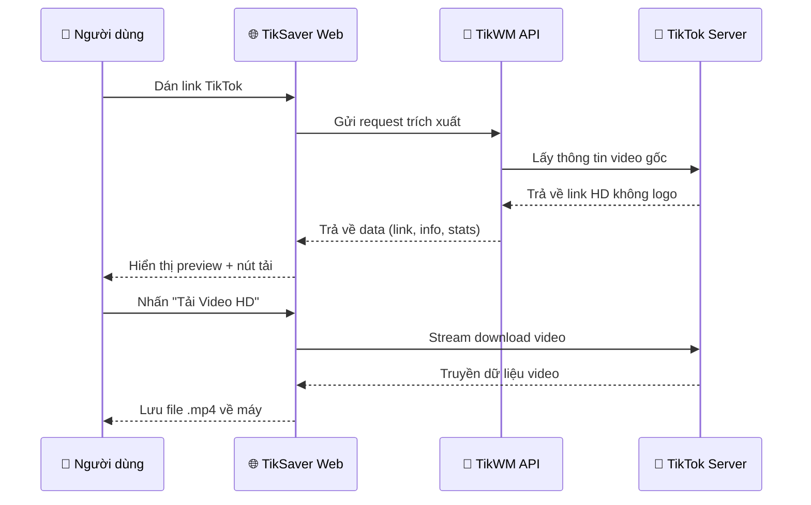

# 🎬 TikSaver — Tải Video TikTok Không Logo HD

<p align="center">
  
  
  
  
</p>

<p align="center">
  <b>Công cụ tải video TikTok không watermark, chất lượng HD cao nhất — hoàn toàn miễn phí!</b>
</p>

---

## ✨ Tính năng

| Tính năng | Mô tả |
|---|---|
| 🚫 **Không watermark** | Tải video TikTok sạch, không logo chìm |
| 🎥 **Chất lượng HD** | Ưu tiên lấy bản video độ phân giải cao nhất |
| ⚡ **Tốc độ nhanh** | Xử lý và tải video chỉ trong vài giây |
| 🎨 **Giao diện đẹp** | UI hiện đại, dark theme, glassmorphism, responsive |
| 📊 **Hiển thị thống kê** | Xem lượt xem, like, comment, share của video |
| 🎵 **Thông tin nhạc** | Hiển thị bài nhạc nền của video |
| 📱 **Responsive** | Hoạt động tốt trên cả máy tính và điện thoại |
| 🔒 **An toàn** | Không lưu trữ dữ liệu người dùng |

## 📸 Giao diện

```
┌─────────────────────────────────────────┐
│           ⚡ TikSaver                    │
│   Tải video TikTok không logo, HD       │
│                                         │
│  ┌─────────────────────────┐ ┌────────┐ │
│  │ 🔗 Dán link TikTok...   │ │🔍 Tìm  │ │
│  └─────────────────────────┘ └────────┘ │
│                                         │
│  ┌─────────────────────────────────────┐│
│  │  🖼️ Video Preview (HD)              ││
│  │  👤 Author Name                     ││
│  │  📝 Video description...            ││
│  │  🎵 Music - Artist                  ││
│  │  ▶️ Views ❤️ Likes 💬 Comments      ││
│  │  ┌──────────┐ ┌──────────────────┐  ││
│  │  │📥 Tải HD │ │🔄 Tải video khác│  ││
│  │  └──────────┘ └──────────────────┘  ││
│  └─────────────────────────────────────┘│
└─────────────────────────────────────────┘
```

## 🚀 Cài đặt & Chạy

### Yêu cầu

- Python 3.8 trở lên
- pip (trình quản lý gói Python)

### Bước 1: Clone repo

```bash
git clone https://github.com/YOUR_USERNAME/tiksaver.git
cd tiksaver
```

### Bước 2: Cài đặt thư viện

```bash
pip install -r requirements.txt
```

### Bước 3: Chạy ứng dụng

```bash
python app.py
```

### Bước 4: Mở trình duyệt

Truy cập 👉 **http://127.0.0.1:5000**

## 📁 Cấu trúc dự án

```
tiksaver/
├── app.py                  # Flask backend server
├── tiktok_downloader.py    # Script CLI (chạy trên terminal)
├── requirements.txt        # Danh sách thư viện cần cài
├── .gitignore              # File bỏ qua khi push Git
├── LICENSE                 # Giấy phép MIT
├── README.md               # File hướng dẫn (bạn đang đọc)
└── templates/
    └── index.html          # Giao diện web (frontend)
```

## 🖥️ Sử dụng qua CLI (Terminal)

Ngoài giao diện web, bạn cũng có thể dùng script dòng lệnh:

```bash
python tiktok_downloader.py
```

Chỉnh sửa link TikTok trong file `tiktok_downloader.py`:

```python
link_tiktok = "https://www.tiktok.com/@username/video/1234567890"
ten_file_luu = "video_khong_logo.mp4"
```

## ⚙️ Cách hoạt động



## 🛡️ Lưu ý quan trọng

> ⚠️ **Disclaimer**: Tool này chỉ dùng cho mục đích cá nhân và học tập. Vui lòng tôn trọng bản quyền nội dung của các creator trên TikTok. Không sử dụng video đã tải để đăng lại hoặc thương mại hóa mà không có sự đồng ý của chủ sở hữu.

## 🤝 Đóng góp

Mọi đóng góp đều được chào đón! Hãy:

1. **Fork** repo này
2. Tạo **branch** mới (`git checkout -b feature/tinh-nang-moi`)
3. **Commit** thay đổi (`git commit -m 'Thêm tính năng mới'`)
4. **Push** lên branch (`git push origin feature/tinh-nang-moi`)
5. Tạo **Pull Request**

## 📜 Giấy phép

Dự án này được phân phối theo giấy phép [MIT](LICENSE). Xem file `LICENSE` để biết thêm chi tiết.

---

<p align="center">
  Made with ❤️ by <a href="https://github.com/YOUR_USERNAME">YOUR_USERNAME</a>
</p>
